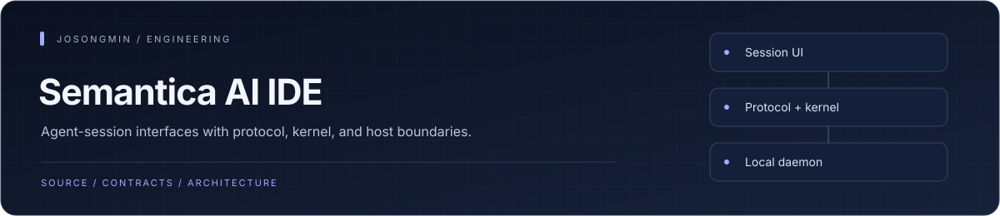
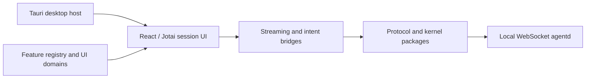

<p align="center"></p>

# Semantica AI IDE

<p align="center"><a href="#engineering-highlights">Engineering</a> · <a href="#architecture-at-a-glance">Architecture</a> · <a href="#run-locally">Get started</a> · <a href="#documentation">Reference</a></p>

An agent-oriented development interface combining code editing, conversation, terminal output, and workspace panels. React, CodeMirror, Jotai, virtualized lists, and xterm provide the UI foundation.

## Engineering highlights

| Mechanism | Engineering purpose | Source |
| :--- | :--- | :--- |
| **Feature-registry bootstrap** | Application startup registers features and wires streaming events into frontend state. | [Bootstrap](src/app/useFeatureBootstrap.ts) |
| **Session-oriented surfaces** | Chat, review, task, and editor views are composed as domains/surfaces rather than one monolithic page. | [Domains](src/domains/) |
| **Protocol and kernel packages** | Dedicated workspace packages hold shared contracts and state-machine concerns. | [Protocol](packages/protocol/) |
| **Local endpoint discovery** | The daemon writes endpoint and process metadata through temporary-file rename, so readers do not consume a partially written record. | [Daemon](apps/agentd/src/main.ts) |
| **Browser and desktop composition** | The web app and desktop package share the UI architecture while native and daemon responsibilities remain separately owned. | [Desktop host](apps/desktop/) |

## Architecture at a glance



## What it does

- Explore source and conversation context in one workspace.
- Compose editor, terminal, and panel features around explicit UX contracts.
- Keep agent runtime, protocol, and extension-host packages separate.
- Develop web, desktop, and daemon entry points within one repository.

## Repository map

| Path | Responsibility |
| --- | --- |
| [src](src) | Screens, features, domains, and shared UI. |
| [schemas/agent-ux](schemas/agent-ux) | UX schemas and contracts. |
| [packages/protocol](packages/protocol) | Protocol definitions. |
| [packages/agent-runtime](packages/agent-runtime) | Agent runtime package. |
| [packages/extension-host](packages/extension-host) | Extension host. |
| [apps](apps) | Desktop, webview development, and daemon applications. |
| [rfc](rfc) | Design documentation. |

## Run locally

Use Node.js and pnpm@9.15.0. Run these commands from the repository root.

```sh
pnpm install --frozen-lockfile
pnpm dev
```

## Development checks

```sh
pnpm typecheck
pnpm lint
pnpm test
pnpm build
```

## Scope and status

This is an earlier Semantica agent-interface workspace. The web shell, desktop application, and daemon have separate configuration and verification requirements. Build-cache locations follow the repository tooling rather than a universal in-tree `target` directory.

## Documentation

- [Design index](rfc/README.md)
- [Repository structure](rfc/REPO-STRUCTURE.md)
- [Panel architecture](docs/RFC-PANEL-ARCHITECTURE.md)
- [Script reference](package.json)

<p align="center"><sub><a href="https://github.com/josongmin">Project map</a> · <a href="#engineering-highlights">Back to overview</a></sub></p>
